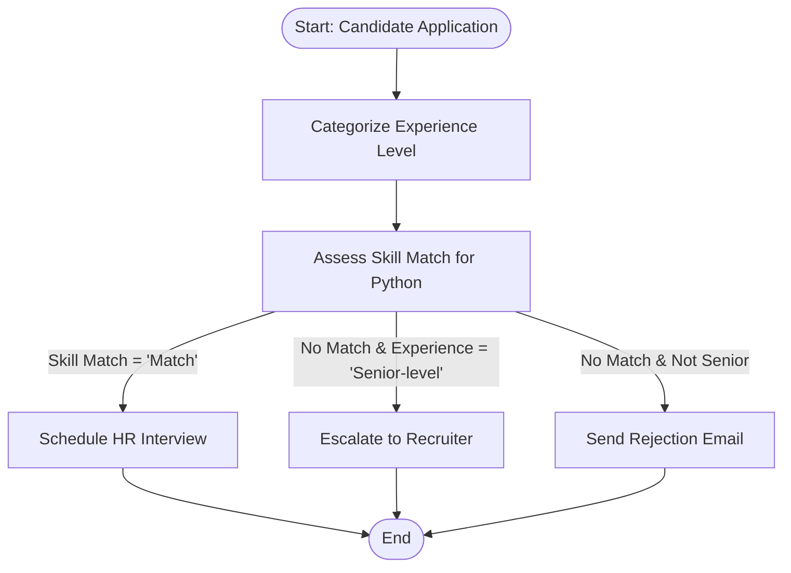

# Automated Candidate Screening System with LangGraph

This project demonstrates how to build an automated job application screening and interview routing workflow using **LangGraph** and Large Language Models (LLMs via Groq / OpenAI).

The notebook (`Langraph_Interview_Selection.ipynb`) automates how an HR team evaluates incoming resumes for a **Python Developer** role and directs candidates to the right next step.

---

## 📌 What Does This Project Do?

When a job applicant submits a short profile summary, the system automatically:
1. **Categorizes Experience**: Uses an LLM to classify the candidate as *Entry-level*, *Mid-level*, or *Senior-level*.
2. **Evaluates Skill Match**: Checks if the candidate possesses Python development skills (*Match* or *No Match*).
3. **Decides the Next Action**:
   - **Shortlist for HR Interview**: If skills match the job requirement.
   - **Escalate to Senior Recruiter**: If skills do not match, but the candidate has senior-level experience (to consider them for other leadership or engineering roles).
   - **Reject Application**: If skills do not match and the candidate is not senior-level.

---

## 🏗️ How It Works (Step-by-Step Flow)

---

## 🔍 Detailed Breakdown of Executed Code

### 1. Installing Libraries & API Setup
- **Libraries**: Installed `langgraph`, `langchain`, `langchain_core`, `langchain_community`, `langchain_openai`, and `langchain_groq`.
- **API Keys**: Loaded OpenAI and Groq API keys securely using Google Colab's secrets (`userdata.get(...)`).
- **LLM Initialization**: Uses Groq (`llama3-8b-8192` / `openai/gpt-oss-20b`) for fast LLM inference.

### 2. Defining the Workflow State (`State`)
LangGraph passes a shared state dictionary across all nodes. The state tracks four key attributes:
- `application`: The candidate's resume/profile text input.
- `experience_level`: Extracted seniority (`Entry-level`, `Mid-level`, `Senior-level`).
- `skill_match`: Whether required skills match the role (`Match` or `No Match`).
- `response`: The final message/action generated by the workflow.

### 3. Creating the Workflow Nodes
Five functions (nodes) perform specific tasks:
- `categorize_experience`: Prompts the LLM to inspect the application and determine seniority.
- `assess_skillset`: Prompts the LLM to verify whether the candidate has the required Python developer skills.
- `schedule_hr_interview`: Sets output to *"Candidate has been shortlisted for an HR interview."*
- `escalate_to_recruiter`: Sets output to *"Candidate has senior-level experience but doesn't match job skills."*
- `reject_application`: Sets output to *"Candidate doesn't meet JD and has been rejected."*

### 4. Setting Up Routing & Graph Connections
- **Sequential Flow**: Starts at `START` ➡️ `categorize_experience` ➡️ `assess_skillset`.
- **Conditional Routing (`route_app`)**:
  - If `skill_match == "Match"` ➡️ routes to `schedule_hr_interview`.
  - Else if `experience_level == "Senior-level"` ➡️ routes to `escalate_to_recruiter`.
  - Otherwise ➡️ routes to `reject_application`.
- All ending decision nodes connect to `END`.
- The graph is compiled with `workflow.compile()`.

---

## 🧪 Test Cases Executed in the Notebook

Here are the real test examples run in the notebook and their outcomes:

| Candidate Input | Experience Level | Skill Match | Final Decision |
| :--- | :--- | :--- | :--- |
| *"I have 10 years of experience in software engineering with expertise in JAVA"* | **Senior-level** | **No Match** | ⚠️ **Escalated to Recruiter** (senior candidate, save for other roles) |
| *"I have 1 year of experience in software engineering with expertise in JAVA"* | **Entry-level** | **No Match** | ❌ **Rejected** (skills don't match JD) |
| *"I have experience in software engineering with expertise in Python"* | **Mid-level** | **Match** | ✅ **Shortlisted for HR Interview** |
| *"I have 5 years of experience in software engineering with expertise in C++"* | **Mid-level** | **No Match** | ❌ **Rejected** (skills don't match JD) |

---

## 🚀 How to Run

1. Open `Langraph_Interview_Selection.ipynb` in Google Colab or Jupyter Notebook.
2. Set your Groq API key in Colab secrets under `GROQ_API_KEY` (or `langchain_api`).
3. Run the notebook cells sequentially to compile the graph.
4. Pass any candidate bio into `run_candidate_screening("<your text>")` to see the automated decision.
